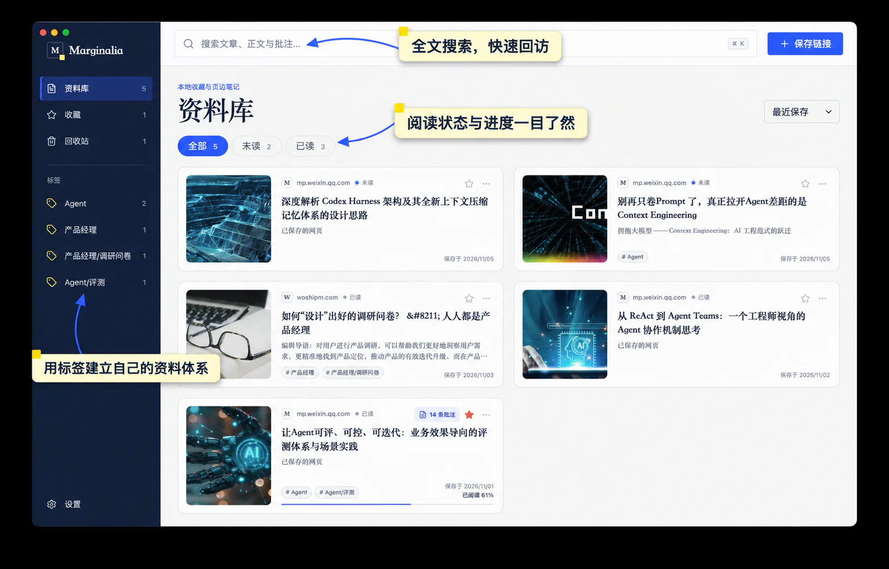
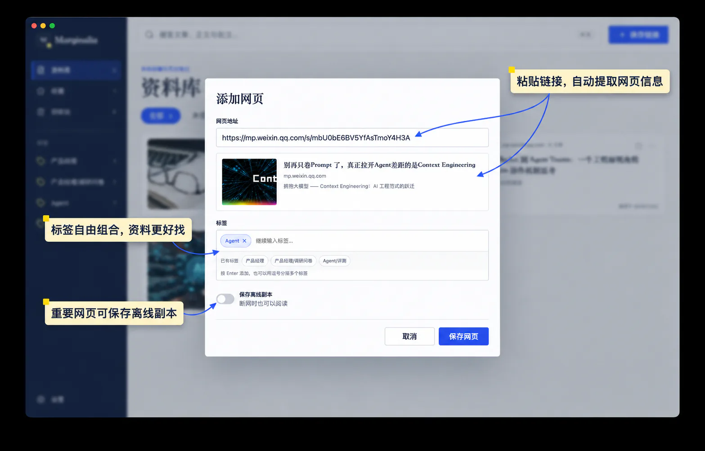
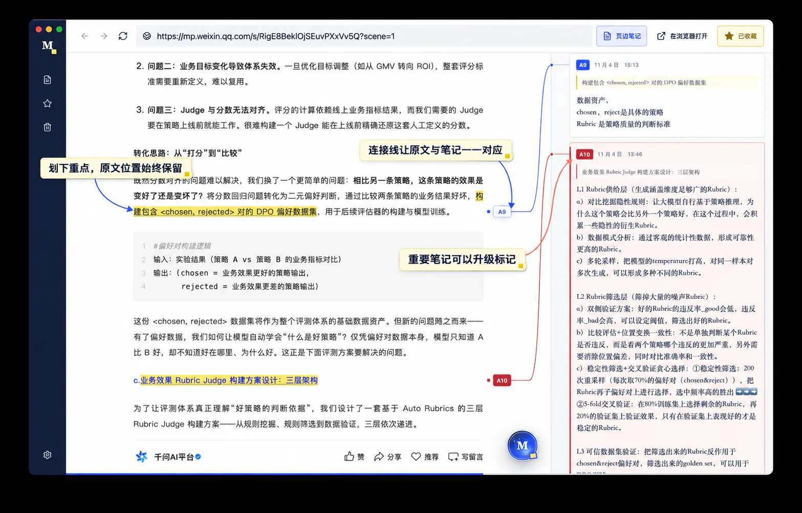
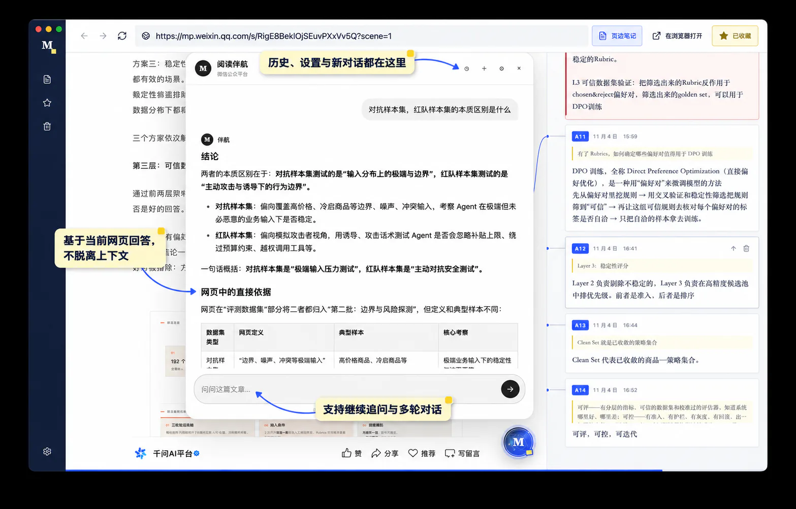

<div align="center">
  

# Marginalia

**Save the web, read in context, think in the margins, and ask AI — all from one local desk.**

[](https://github.com/qfzhao670/Marginalia/releases/latest)


[Download](https://github.com/qfzhao670/Marginalia/releases/latest) · [Highlights](#why-marginalia) · [AI companion](#ai-reading-companion) · [Development](#local-development)

[简体中文](./README.md) · English
</div>

---

Marginalia is a local-first desktop library for the web. Save a link and it automatically collects the page title, description, cover image, and searchable text. Open it again to read within the original layout and context, highlight passages, attach notes directly to the source, and ask AI about the whole article or a selected excerpt.

It is made for researchers, creators, and lifelong learners who want “read later” to become “read, understood, and remembered.”

<p align="center">
  
</p>
<p align="center"><sub>The real library interface: collect, search, and organize pages by tags and reading status.</sub></p>

## Why Marginalia

- **More than a saved URL** — Capture titles, descriptions, cover images, and searchable page text, then organize everything with tags, favorites, read status, and reading progress.
- **Read on the original page** — The built-in browser preserves the website's layout and context, so you do not have to switch between a stripped reader view and the source.
- **Notes that stay with the text** — Highlight a passage and write beside it. Visual connectors keep source text and margin notes paired as you move through the article.
- **AI designed for understanding** — Summarize a page, map its argument, explain a term, or ask follow-up questions about a selection. Each saved page keeps its own conversation history.
- **Local-first and offline-capable** — Bookmarks, tags, reading progress, annotations, and AI conversations stay on your computer by default. Keep offline copies of important pages and export all your data as a JSON backup whenever you want.
- **Built for a long-lived library** — Full-text and tag search, annotation previews, promoted notes, Trash, and restore make the collection easier to revisit over time.

## From capture to understanding

1. **Save** — Paste a URL, review the extracted metadata, add tags, and optionally keep an offline copy.
2. **Read** — Open the original page inside Marginalia while reading progress is recorded automatically.
3. **Annotate** — Select text to highlight it, then add a margin note anchored to that passage.
4. **Ask** — Use AI to summarize, explain, or discuss the current page or selection over multiple turns.
5. **Revisit** — Find important sources and ideas again through search, tags, favorites, and annotation previews.

<p align="center">
  
</p>
<p align="center"><sub>Save a page: extract its details, combine tags, and optionally keep an offline copy.</sub></p>

<p align="center">
  
</p>
<p align="center"><sub>Original-page reading and margin notes: every idea stays connected to its source passage.</sub></p>

## AI reading companion

The AI reading companion is optional, and Marginalia does not lock you into a particular model or provider. Use it to summarize the current page, map an argument, explain unfamiliar terms, or continue asking questions about a selected passage.

<p align="center">
  
</p>
<p align="center"><sub>AI reading companion: answers from the current page, preserves context, and supports follow-up questions.</sub></p>

1. Open **Settings (`设置`) → AI reading companion (`AI 阅读伴航`)**.
2. Enter the base URL and model name for an OpenAI-compatible service, plus an API key if that service requires one.
3. Open any saved page and use the floating companion to discuss the full article, or select a passage and choose **Ask companion (`问伴航`)**.

Compatible services include OpenAI, OpenRouter, Ollama, and LM Studio. The default configuration points to a local Ollama instance:

```text
Base URL: http://127.0.0.1:11434/v1
Model:    qwen3:4b
```

> [!NOTE]
> The current page text, your question, and any selected excerpt are sent to the configured model service only when you actively use AI. A local Ollama or LM Studio endpoint keeps that processing on your machine.

## Download and install

Visit [GitHub Releases](https://github.com/qfzhao670/Marginalia/releases/latest) and download the package that matches your system.

| Platform | Architecture | Package |
| --- | --- | --- |
| Windows | x64 | `Marginalia-Setup-*-x64.exe` |
| macOS | Intel / Apple Silicon | `Marginalia-*-universal.dmg` |
| Linux | x64 | `Marginalia-*-x86_64.AppImage` |

On Linux, make the AppImage executable before launching it:

```bash
chmod +x Marginalia-*.AppImage
./Marginalia-*.AppImage
```

> [!IMPORTANT]
> Public builds are not code-signed yet. Windows SmartScreen may show an “Unknown publisher” warning, and macOS may ask you to approve the app under **System Settings → Privacy & Security**. Only download builds from this repository's Releases page.

## Data and privacy

- No Marginalia account is required, and the app does not depend on a Marginalia cloud service.
- Bookmarks, tags, progress, annotations, Trash, and AI conversations are stored in Electron's local application-data directory.
- API keys are encrypted with Electron `safeStorage` when the operating system supports it.
- Saving or reading a link connects directly to its website. Relevant reading context is sent to your configured model service only when you actively make an AI request.
- Export a complete JSON backup from **Settings (`设置`) → Data backup (`数据备份`)**.

## Local development

You will need [Node.js 22](https://nodejs.org/) and npm.

```bash
git clone https://github.com/qfzhao670/Marginalia.git
cd Marginalia
npm ci
npm run dev
```

Common commands:

| Command | Purpose |
| --- | --- |
| `npm run dev` | Start Vite and Electron in development mode |
| `npm run build` | Type-check and build the renderer |
| `npm run package` | Create an unpacked app for the current platform |
| `npm run dist:win` | Build the Windows x64 installer |
| `npm run dist:mac` | Build the macOS Universal packages |
| `npm run dist:linux` | Build the Linux x64 AppImage |

## Tech stack

- Electron 33
- React 18 + TypeScript
- Vite 6
- Motion
- Lucide React
- electron-builder

> [!NOTE]
> Marginalia is still at an early stage. A website's authentication, anti-bot rules, or page structure may affect metadata extraction and offline saves. Export regular backups of important material.
