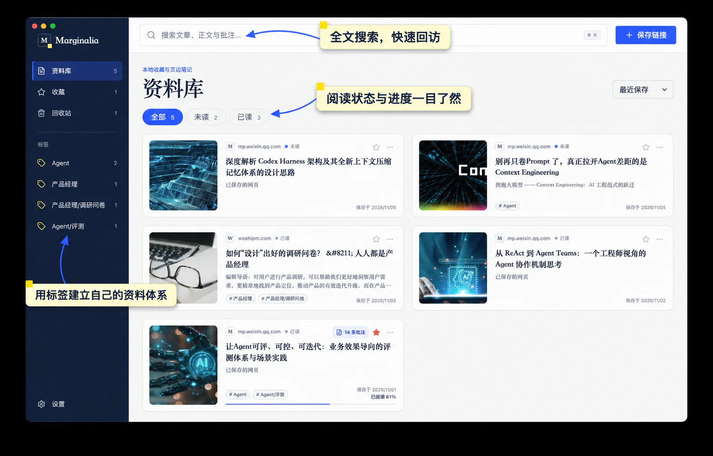
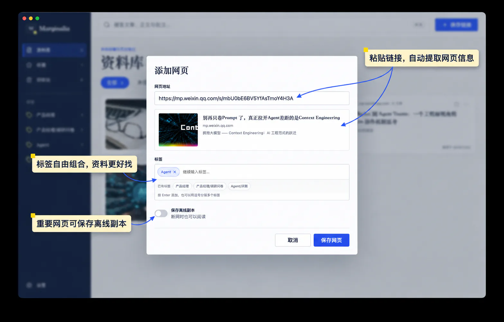
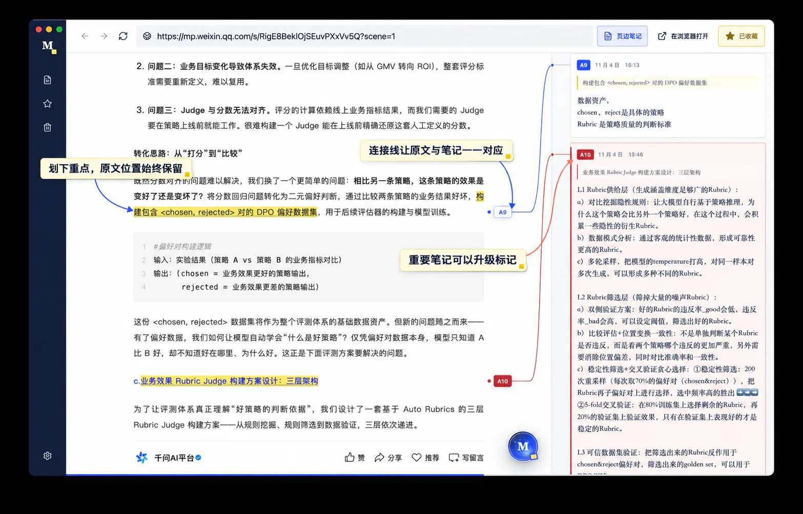
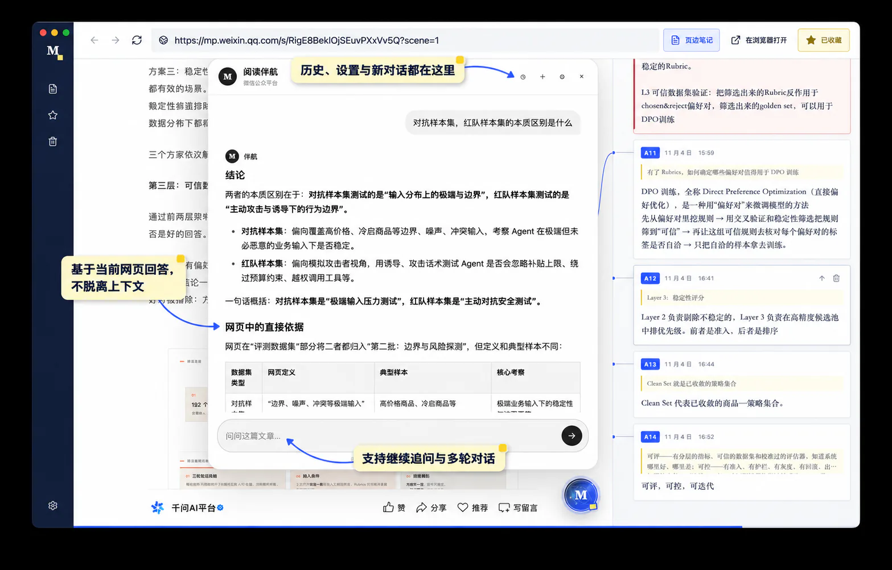

<div align="center">
  

# Marginalia

**把网页收藏、原文阅读、页边笔记与 AI 对话，收进同一张本地书桌。**

[](https://github.com/qfzhao670/Marginalia/releases/latest)


[下载最新版](https://github.com/qfzhao670/Marginalia/releases/latest) · [功能一览](#为什么选择-marginalia) · [AI 阅读伴航](#ai-阅读伴航) · [本地开发](#本地开发)

简体中文 · [English](./README.en.md)
</div>

---

Marginalia 是一款本地优先的桌面网页资料库。保存一个链接，它会自动整理网页的标题、摘要、封面与正文；再次打开时，你仍然在原网页的排版与上下文中阅读，还可以划线、写下与原文相连的页边笔记，并让 AI 围绕全文或选中段落继续解释。

它适合希望把“稍后读”真正变成“读过、想过、留下来”的研究者、创作者和终身学习者。

<p align="center">
  
</p>
<p align="center"><sub>真实资料库界面：集中收藏、搜索并按标签与阅读状态整理网页</sub></p>

## 为什么选择 Marginalia

- **收藏不止是一个网址**：自动抓取标题、摘要、封面与可搜索的正文，再用标签、收藏状态、已读状态和阅读进度整理资料。
- **在原网页上阅读**：内置浏览器保留网页本来的排版与上下文，无需在“阅读器版本”和原站之间来回切换。
- **真正贴着原文的笔记**：选中文字即可高亮并补充笔记；连接线把段落与页边卡片对应起来，滚动文章时也能快速找到彼此。
- **面向理解的 AI 伴航**：总结全文、梳理论证、解释术语，或针对选中段落追问。每篇网页保留独立的多轮对话历史。
- **本地优先，也能离线**：收藏、标签、阅读进度、批注和 AI 对话默认保存在本机；重要网页可以保存离线副本，全部数据也能随时导出为 JSON 备份。
- **为长期资料库准备**：全文与标签搜索、批注速览、重点笔记、回收站和恢复机制，让资料随着阅读逐步沉淀。

## 从收藏到理解

1. **保存** — 粘贴网页地址，确认自动提取的信息，添加标签并按需保存离线副本。
2. **阅读** — 在应用内打开原网页，Marginalia 自动记录阅读进度。
3. **批注** — 拖动选中文字，保存高亮，在右侧写下与原文锚定的页边笔记。
4. **追问** — 让 AI 基于当前网页或选中内容进行总结、解释和多轮讨论。
5. **重访** — 通过搜索、标签、收藏和批注速览，重新找到重要内容与当时的想法。

<p align="center">
  
</p>
<p align="center"><sub>保存网页：自动提取信息、组合标签，并按需保留离线副本</sub></p>

<p align="center">
  
</p>
<p align="center"><sub>原文阅读与页边笔记：每条想法都能回到它所依据的段落</sub></p>

## AI 阅读伴航

AI 阅读伴航是可选功能，Marginalia 不绑定特定模型或服务商。它可以围绕当前网页总结内容、梳理论证、解释术语，也可以针对你选中的段落继续追问。

<p align="center">
  
</p>
<p align="center"><sub>AI 阅读伴航：依据当前网页回答，保留原文上下文并支持多轮追问</sub></p>

1. 打开 **设置 → AI 阅读伴航**。
2. 填写兼容 OpenAI API 的服务地址、模型名称，以及该服务所需的 API Key。
3. 打开任意收藏网页，通过悬浮入口与全文对话；也可以选中一段文字，再点击“问伴航”。

目前可接入 OpenAI、OpenRouter、Ollama、LM Studio 等兼容服务。默认配置指向本机 Ollama：

```text
Base URL: http://127.0.0.1:11434/v1
Model:    qwen3:4b
```

> [!NOTE]
> 只有在你主动使用 AI 时，当前网页正文、你的问题以及选中的文本（如有）才会发送到所配置的模型服务。使用本机 Ollama 或 LM Studio，可以让这部分处理留在本机。

## 下载与安装

前往 [GitHub Releases](https://github.com/qfzhao670/Marginalia/releases/latest)，下载与你的系统匹配的安装包。

| 系统 | 架构 | 安装包 |
| --- | --- | --- |
| Windows | x64 | `Marginalia-Setup-*-x64.exe` |
| macOS | Intel / Apple Silicon | `Marginalia-*-universal.dmg` |
| Linux | x64 | `Marginalia-*-x86_64.AppImage` |

Linux 用户下载后，需要先赋予 AppImage 执行权限：

```bash
chmod +x Marginalia-*.AppImage
./Marginalia-*.AppImage
```

> [!IMPORTANT]
> 当前公开安装包尚未进行代码签名。Windows SmartScreen 可能提示“未知发布者”；macOS 可能需要你前往“系统设置 → 隐私与安全性”确认打开。请只从本仓库的 Releases 页面下载安装包。

## 数据与隐私

- 不需要注册 Marginalia 账号，也不依赖 Marginalia 云端服务。
- 收藏、标签、阅读进度、批注、回收站和 AI 对话保存在 Electron 的本机应用数据目录中。
- API Key 在操作系统支持时通过 Electron `safeStorage` 加密保存。
- 保存链接或阅读网页时，应用会直接访问对应网站；只有在你主动发起 AI 请求时，相关的阅读上下文才会发送到所配置的模型服务。
- 可在 **设置 → 数据备份** 中导出完整 JSON 备份。

## 本地开发

需要 [Node.js 22](https://nodejs.org/) 与 npm。

```bash
git clone https://github.com/qfzhao670/Marginalia.git
cd Marginalia
npm ci
npm run dev
```

常用命令：

| 命令 | 作用 |
| --- | --- |
| `npm run dev` | 同时启动 Vite 与 Electron 开发环境 |
| `npm run build` | 类型检查并构建渲染进程 |
| `npm run package` | 生成当前平台的未打包应用目录 |
| `npm run dist:win` | 构建 Windows x64 安装包 |
| `npm run dist:mac` | 构建 macOS Universal 安装包 |
| `npm run dist:linux` | 构建 Linux x64 AppImage |

## 技术栈

- Electron 33
- React 18 + TypeScript
- Vite 6
- Motion
- Lucide React
- electron-builder

> [!NOTE]
> Marginalia 仍处于早期版本。网站的登录状态、反爬策略或页面结构都可能影响元数据抓取与离线保存效果；对于重要资料，建议定期导出备份。
